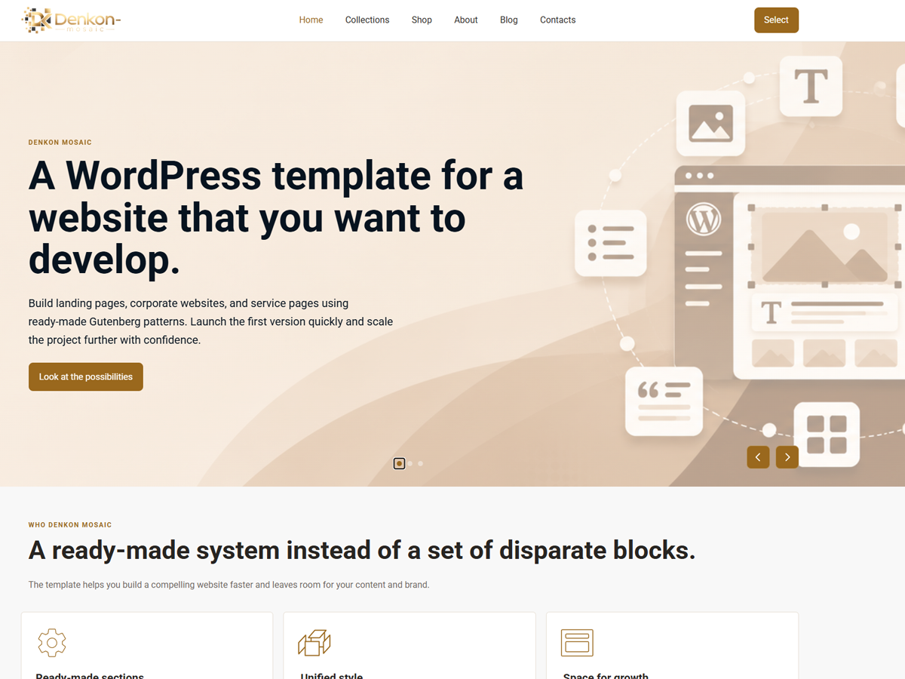

# Denkon Mosaic

**Denkon Mosaic** is a lightweight, flexible classic WordPress theme for business websites, agencies, experts and service providers. It combines the familiar WordPress theme experience with editable Gutenberg patterns — without a proprietary page builder.



## Highlights

- Responsive classic WordPress theme with accessible mobile navigation.
- Native Gutenberg workflow: every included section is built from standard WordPress blocks.
- Ready-made block patterns for hero sections, benefits, services, steps, FAQs, galleries, partners, testimonials, contact forms and company information.
- Custom logo, featured images, responsive embeds and wide block support.
- Primary and footer menu locations.
- Appearance settings for colour scheme, content width, header, footer and typography.
- English and Russian interface option in the theme settings.
- Safe administrator-only SVG upload sanitization.
- Child-theme friendly, with a built-in child-theme creation tool.
- No external services, tracking, user accounts or third-party data transfer.

## Requirements

- WordPress 6.4 or newer
- PHP 7.4 or newer

## Installation

1. Download or clone this repository.
2. Create a ZIP archive whose root folder is `denkon-mosaic`.
3. In WordPress, open **Appearance → Themes → Add New → Upload Theme**.
4. Upload the archive and activate **Denkon Mosaic**.
5. Open **Appearance → Denkon Mosaic** to configure the theme.
6. Assign menus under **Appearance → Menus** to the **Primary** and **Footer** locations.
7. While editing a page or post, add the included sections from the block inserter under **Patterns**.

## Customization

The theme is designed so that ordinary site changes stay inside WordPress:

- edit text, images, colours, links and spacing directly in the Block Editor;
- select a colour scheme and control the content width in the theme settings;
- change the interface language between English and Russian;
- replace the site logo and configure navigation menus;
- create a child theme when custom templates or code are needed.

Changing the theme interface language affects theme controls and newly inserted patterns only. Existing posts and pages are not rewritten.

## Project structure

```text
denkon-mosaic/
├── assets/       # Compiled styles, JavaScript, LESS sources and local images
├── inc/          # Theme setup, settings, assets, patterns and integrations
├── patterns/     # Editable Gutenberg block patterns
├── functions.php # Theme bootstrap
├── style.css     # WordPress theme metadata and base stylesheet
└── theme.json    # Editor settings, colour palette and typography tokens
```

## Development

The committed CSS in `assets/css/` is used by WordPress. LESS source files are located in `assets/less/` and follow the same component structure. JavaScript uses vanilla JavaScript; no front-end framework or page builder is required.

Please keep changes compatible with PHP 7.4+ and WordPress 6.4+.

## License

Denkon Mosaic is distributed under the [GNU General Public License v2.0 or later](LICENSE.txt).

All PHP, JavaScript, CSS, LESS and bundled SVG assets are copyright © 2026 Denkon and licensed under GPL-2.0-or-later.

## Author

Created by [Denkon](https://denkon.ru).
